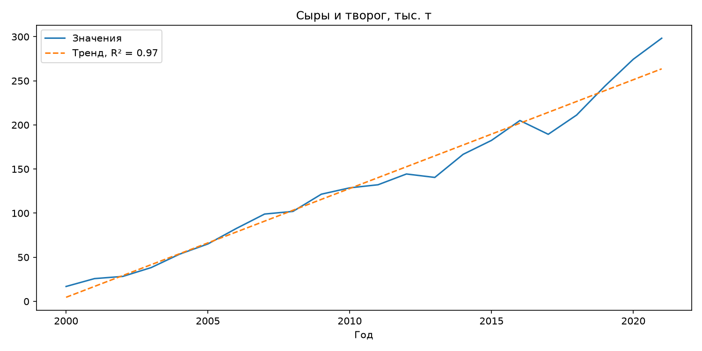
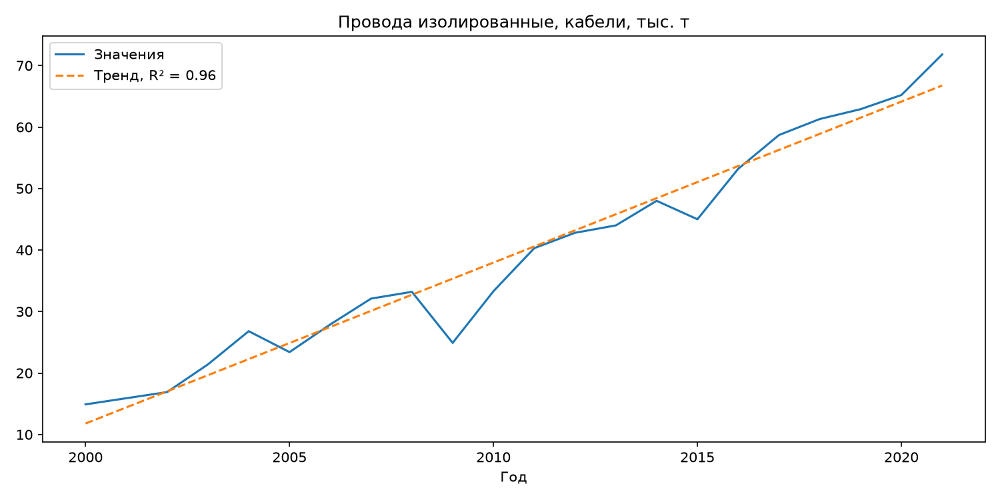
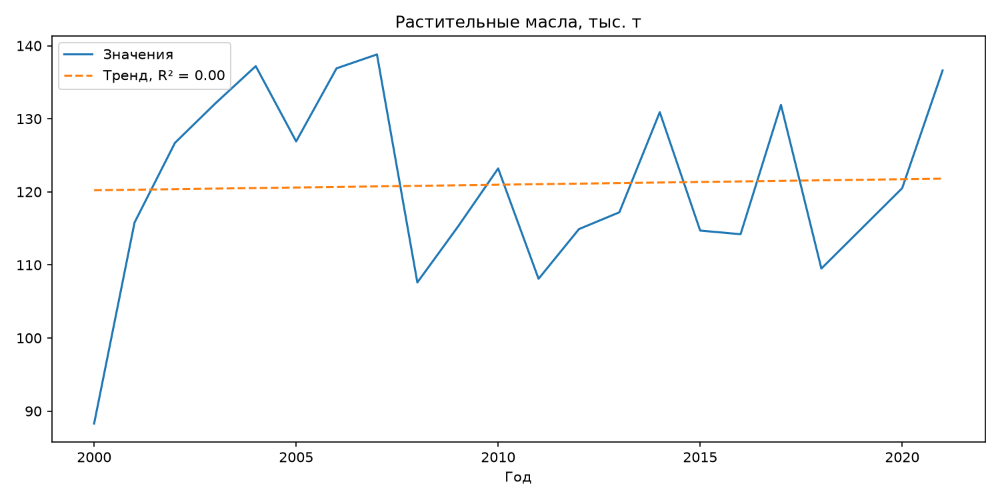
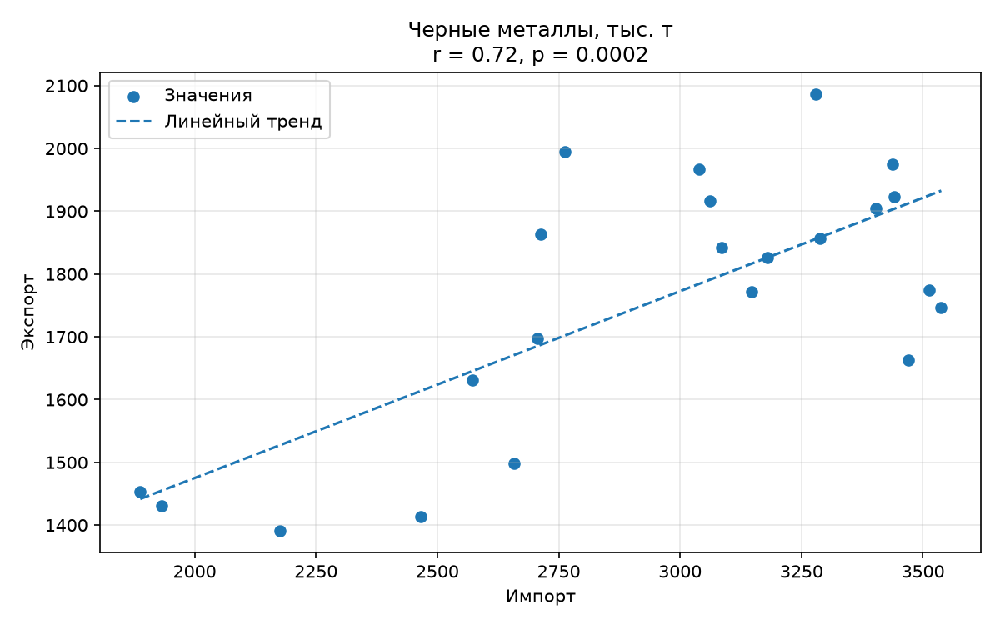
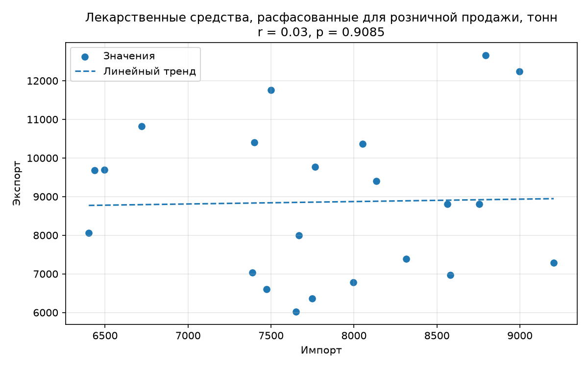
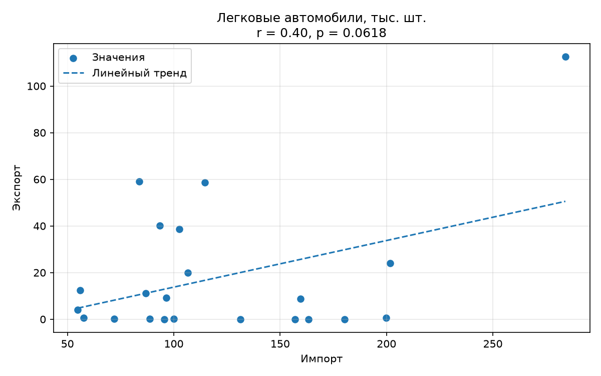
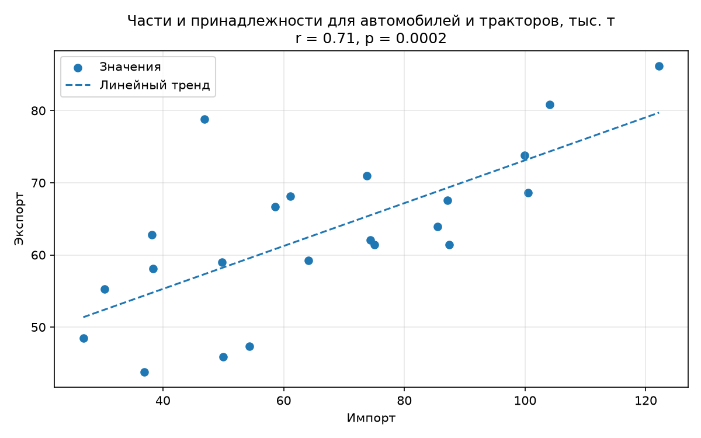

# Задание 1

На основании данных Национального статистического комитета Республики Беларусь: Импорт важнейших видов продукции (.xlsx) и Экспорт важнейших видов продукции (.xlsx) провести анализ представленных данных. Необходимо:

- средствами Python или с применением BI-инструмента (предпочтительно) отобразить возможные графики и диаграммы;
- сделать выводы - подготовить текстовое описание с анализом ключевых трендов, зависимостей и аномалий;
- результат представить в виде ссылки на github.

# Вывод по задаче

При первичном анализе обоих таблиц было выявлено, что экспорт легковых автомобилей был в штуках, хотя импорт ведется в тысячах. Поэтому сперва необходимо перевести экспорт так же к тысячам.

## Зависимости

### Линия тренда

Далее, построим графики зависимости объема импорта/экспорта от года, а так же проведем на них линию тренда

Возьмем для примера два графика экспорта - Сыров, творога и проводов, кабелей. Для того, чтобы понять, что линия тренда близка к реальной - необходимо вычислить R² (коэф детерминации). Чем ближе он к 1, тем точнее тренд описывает данные. Сама линия тренда строится по линейной мат. модели

|            Экспорт сыров, творога             |          Экспорт проводов, кабелей           |
| :-------------------------------------------: | :------------------------------------------: |
|  |  |

По графикам видно:

- общий рост экспорта
- для сыров и творога R-квадрат равно 0.97. Линейный тренд хорошо описывает изменения показателя
- для проводов и кабелей R-квадрат равен 0.96. Линейный тренд так же хорошо описывает изменения показателя
- визуально так же видно, что линия тренда достаточно точна

Однако, линейная линия тренда не всегда может описать график. Например, график импорта растительных масел:

Тут R-квадрат равен 0.00 (на самом деле 0.002). Это означает, что линейный тренд не описывает график зависимости. Так же на графике видны скачки вверх и вниз значения. Поэтому зависимость установить трудно (это и подтвердилось низким R-квадрат)

Остальные графики сохранены в папке [plots/linear](https://github.com/kawunus/data-analysys-test-task/tree/main/task1/plots/linear).

### Корреляция

У нас всего 4 вида товаров, которые есть и в таблице импорта и в таблице экспорта - Черные металлы, автозапчасти, легковые автомобили и лекарства

Можно посчитать корреляцию между импортом и экспортом и выяснить, зависит ли импорт от экспорта

Используя функции Python посчитаем:

| Вид продукции                                      | r(коэфициент корреляции) |
| -------------------------------------------------- | -----------------------: |
| Чёрные металлы                                     |                     0.72 |
| Лекарственные средства                             |                     0.03 |
| Легковые автомобили                                |                      0.4 |
| Части и принадлежности для автомобилей и тракторов |                     0.71 |

Чем ближе r к |1|, тем сильнее связь двух величин. Так как r>0, то связь - прямопропорциональная. Т.е. чем больше импорт, тем больше экспорт

Наиболее заметная связь наблюдается для чёрных металлов и автозапчастей. Для легковых автомобилей связь слабее. А для лекарственных средств связь практически отсутствует.

Однако, можно вычислить p (коэфциент значимости). Чем он меньше, тем более значима связь. При p<0.05 принято принимать связь статистически значимой

| Вид продукции                                      |    r |      p |
| -------------------------------------------------- | ---: | -----: |
| Чёрные металлы                                     | 0.72 | 0.0002 |
| Лекарственные средства                             | 0.03 | 0.9085 |
| Легковые автомобили                                |  0.4 | 0.0618 |
| Части и принадлежности для автомобилей и тракторов | 0.71 | 0.0002 |

P можно вычислить так же с помощью Python.

По таблице выше видно, что у чёрных металлов и автозапчастей связь статистически значимая, так как p < 0.05.

А у остальной продукции связь статистически не значимая.

### Точечные диаграммы связи импорта и экспорта

Можно построить точечные диаграммы зависимости продукции. Точки на графике показывают значения импорта и экспорта за один год. По горизонтальной оси указан импорт, по вертикальной — экспорт. Пунктирная линия показывает общий тренд связи между показателями.

|                     Чёрные металлы                     |                Лекарственные средства                |
| :----------------------------------------------------: | :--------------------------------------------------: |
|  |     |
|                  Легковые автомобили                   |                     Автозапчасти                     |
|      |  |

На графике чёрных металлов точки в целом направлены снизу вверх. Это совпадает с рассчитанным коэффициентом корреляции r = 0.72. Связь является статистически значимой, так как p<0.05.

На графике автозапчастей такая же ситуация. Точки напралены снизу вверх. Это совпадает с рассчитанным коэффициентом корреляции r = 0.71. Связь является статистически значимой, так как p<0.05.

А на двух остальных графиках точки расположены хаотично. Связь статистически не значима, так как у обоих p>0.05
