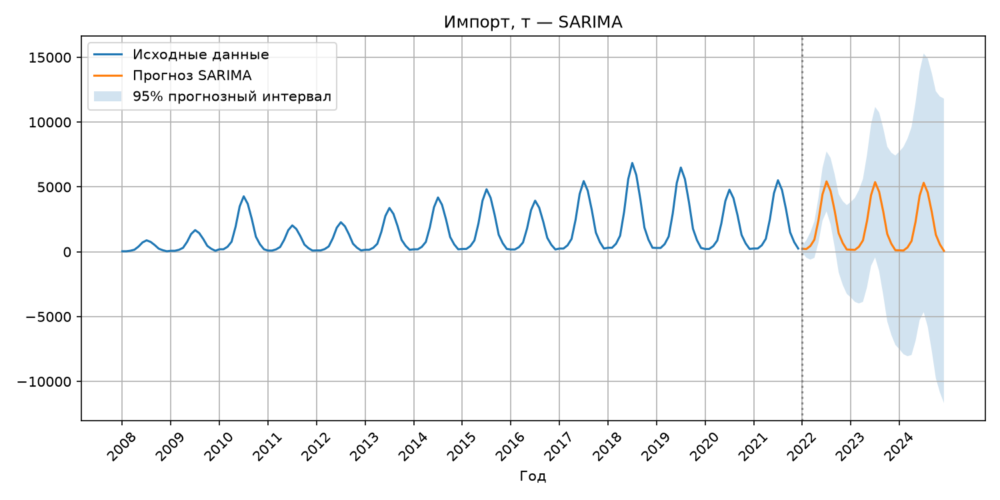
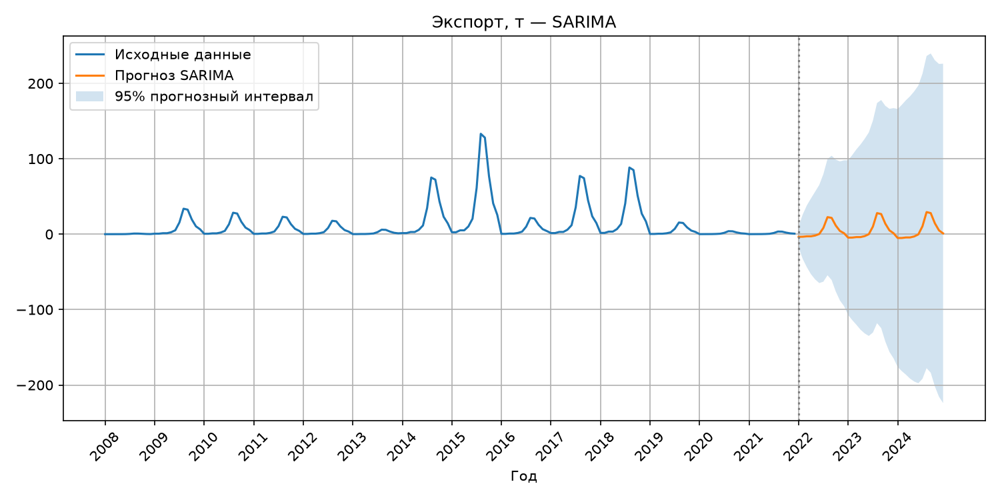
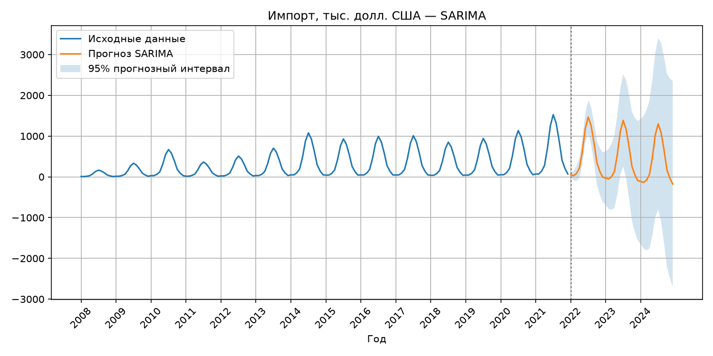
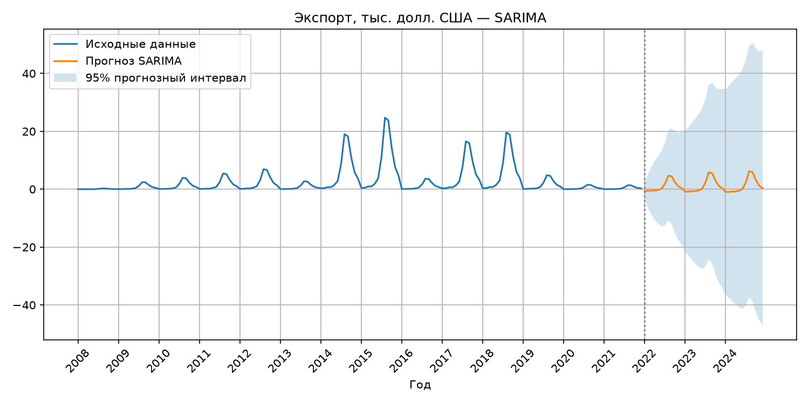
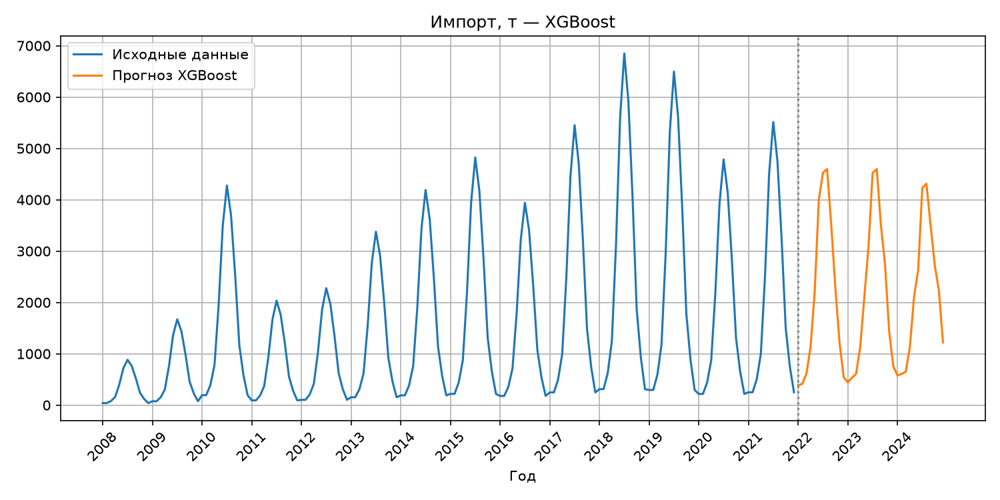
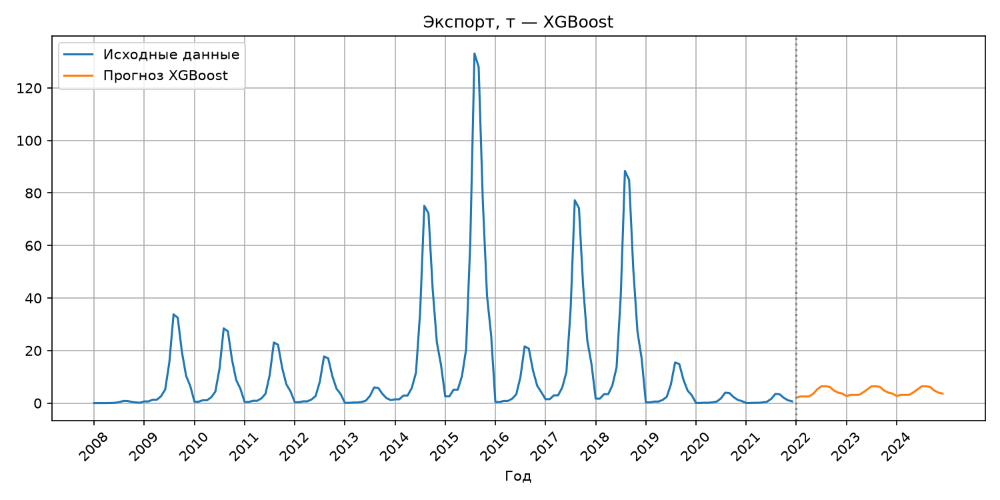
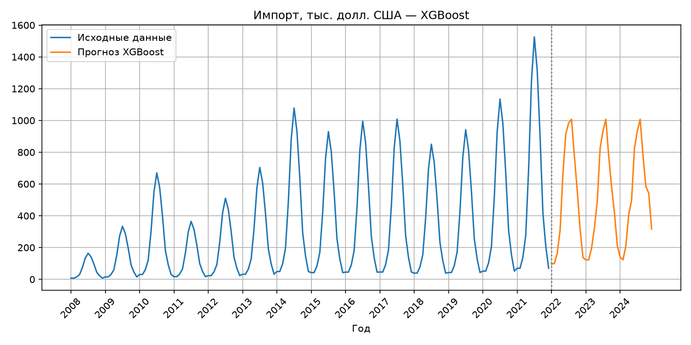
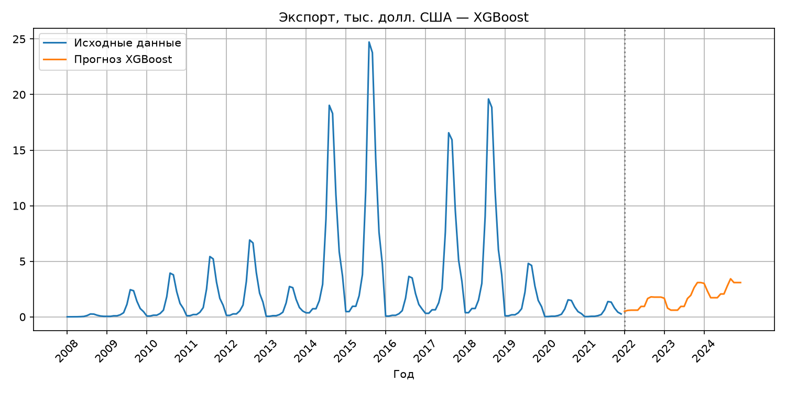
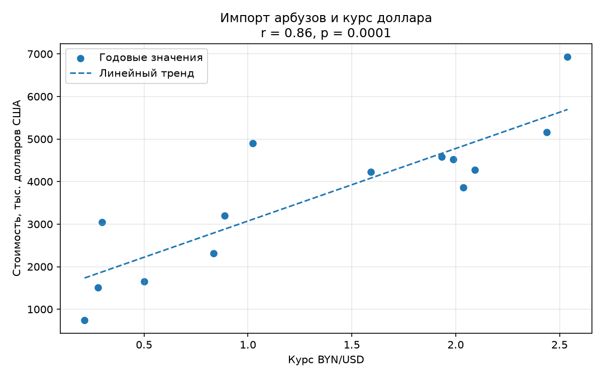
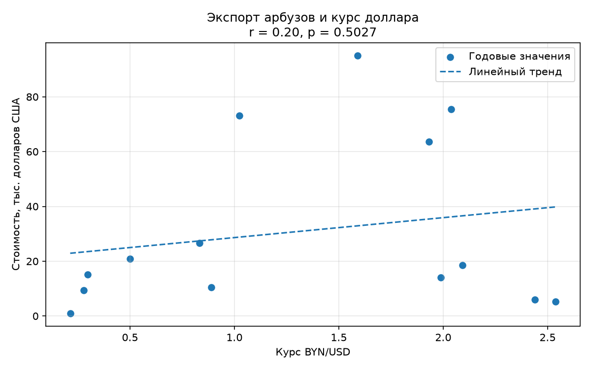

# Задание 2

На основании данных Национального статистического комитета Республики Беларусь https://www.belstat.gov.by/ofitsialnaya-statistika/realny-sector-ekonomiki/vneshnyaya-torgovlya/vneshnyaya-torgovlya-tovarami/godovye-dannye/eksport-i-import-tovarov-6-znakov-tn-ved-eaes/ за 2008-2021 гг. (файлы раздела II Продукты растительного происхождения (.xls), необходимо выполнить:

- декомпозицию рядов (выделение тренда, сезонности и остатков);
- прогноз импорта и экспорта на 2022-2024 годы по товарной группе «Арбузы свежие» (код ТН ВЭД на уровне 6 цифр :080711) в количественном и стоимостном выражении (в результате, должно быть 4 показателя с прогнозом на 3 года каждый). Для прогноза использовать минимум два подхода: статистический (SARIMA, Prophet, др.) и машинного обучения (XGBoost, LightGBM, LSTM, др.). Обосновать выбор лучшей модели на основе метрик качества;
- собрать данные по курсам валют (BYN/USD) за период 2008–2024 гг. и исследовать корреляцию между стоимостью импорта/экспорта арбузов и курсом доллара;
- отобразить визуально исходные данные, компоненты разложения (тренд/цикл/сезонность) и итоговый прогноз с доверительным интервалом средствами Python;
- предоставить подробное текстовое описание методологии, интерпретацию полученных результатов и финальные выводы по каждому блоку анализа;
- результат представить в виде ссылки на github.

## Подготовка данных

Так как часть данных с сайта представлена в виде ПДФ было принято решение не писать парсер данных, а вручную перенести строки для арбузов. Так же я ввел синтетические данные по месяцам, чтобы рассчитать сезонность. Ссылка на файл с данными - [data/data.xlsx](https://github.com/kawunus/data-analysys-test-task/tree/main/task2/data/data.xlsx).

## Декомпозиция рядов

Я разделил ряд значений на тренд, повторяемость и остатки. Графики представлены ниже:

|                       Импорт                        |                       Экспорт                        |
| :-------------------------------------------------: | :--------------------------------------------------: |
|           |           |
|                       Импорт                        |                       Экспорт                        |
|  |  |

По этим графикам видно:

- у импорта тренд - положительный. у экспорта очень сильно колеблется, поэтому сложно сказать, положительный он, или отрицательный.
- наиболее больший импорт арбузов получился за июль, а экспорт в августе (что логично, так как это сезоны для арбузов). Наименьший - у обоих февраль
- остатки колеблятся около нуля без выраженного тренда или сезонного рисунка. Есть выраженные месяцы, где видны отклонения

Сезонность можно было посчитать путем построения одной из моделей - аддиктивной или мультипликативной. Более лучшая модель вычислялась так: считалась величина MAD для каждой модели (Абсолютная средняя ошибка). Она вычисляется по принципу: на основе составленой прогнозируемой модели прогнозируются данные на известные годы, а затем они сравниваются с реальными значениями. Это будет ошибка. Затем все ошибки складываются. Та модель, у которой MAD меньше принято считать более точной (так как средняя ошибка у нее и меньше). На этих данных получилось так, что мультипликативная модель во всех 4х случаях оказалась точнее.

## Прогнозирование

Для статистического прогноза была выбрана модель SARIMА(т.к. у нас есть данные по месяцам, и она расчитана именно на такой случай). Она расчитала значения помесячно, 2022-2024 годы. Затем, месячные прогнозы были сложены в годовые.

Результаты значений представлены в виде графиков ниже, а так же в виде таблицы ниже

|                        Импорт                         |                        Экспорт                         |
| :---------------------------------------------------: | :----------------------------------------------------: |
|           |           |
|  |  |

| Показатель             |      2022 |      2023 |      2024 |
| ---------------------- | --------: | --------: | --------: |
| Импорт, тонн           | 24 260.54 | 23 559.30 | 22 945.91 |
| Импорт, тыс. долларов  |  6 218.09 |  5 227.05 |  4 231.67 |
| Экспорт, тонн          |     55.54 |     65.67 |     66.33 |
| Экспорт, тыс. долларов |     12.51 |     14.71 |     15.10 |

Период у модели составил 12 месяцев. Эта модель учитывает связь с прошлыми месяцами. Так же на графиках показан интервал, в который с 95% шансом, реальные данные могут попасть

Так же, для дальнейшего сравнения с методом машинного обучения был вычислен MAD

| Показатель |    MAD | Единица измерения |
| ---------- | -----: | ----------------- |
| Импорт     | 3355.0 | тонн              |
| Импорт     | 841.47 | тыс. долларов     |
| Экспорт    | 315.11 | тонн              |
| Экспорт    |  68.86 | тыс. долларов     |

Для прогнозирования на основе модели машинного обучения была выбрана модель XGBoost

Она дала результаты, представленные ниже:

|                         Импорт                         |                         Экспорт                         |
| :----------------------------------------------------: | :-----------------------------------------------------: |
|           |           |
|  |  |

| Показатель             |      2022 |      2023 |      2024 |
| ---------------------- | --------: | --------: | --------: |
| Импорт, тонн           | 25 418.58 | 25 451.60 | 25 940.65 |
| Импорт, тыс. долларов  |  6 028.60 |  6 012.71 |  6 363.38 |
| Экспорт, тонн          |     49.82 |     52.87 |     52.87 |
| Экспорт, тыс. долларов |     13.56 |     18.56 |     30.11 |

| Показатель |      MAD | Единица измерения |
| ---------- | -------: | ----------------- |
| Импорт     | 4 493.60 | тонн              |
| Импорт     | 1 125.58 | тыс. долларов     |
| Экспорт    |   167.43 | тонн              |
| Экспорт    |    57.53 | тыс. долларов     |

Далее можно сравнить MAD для каждого из показателей. У того, у кого MAD меньше, та модель и точнее к данным

| Показатель             | MAD SARIMA | MAD XGBoost | Выбор модели |
| ---------------------- | ---------: | ----------: | ------------ |
| Импорт, тонн           |   3 355,00 |    4 493,60 | SARIMA       |
| Импорт, тыс. долларов  |     841,47 |    1 125,58 | SARIMA       |
| Экспорт, тонн          |     315,11 |      167,43 | XGBoost      |
| Экспорт, тыс. долларов |      68,86 |       57,53 | XGBoost      |

Получилось, что для прогнозирования импорта, SARIMA точнее, а для экспорта - XGBoost точнее. Следовательно, прогноз на 2022-2024 годы будет таким:

| Показатель             |      2022 |      2023 |      2024 |
| ---------------------- | --------: | --------: | --------: |
| Импорт, тонн           | 24 260.54 | 23 559.30 | 22 945.91 |
| Импорт, тыс. долларов  |  6 218.09 |  5 227.05 |  4 231.67 |
| Экспорт, тонн          |     49.82 |     52.87 |     52.87 |
| Экспорт, тыс. долларов |     13.56 |     18.56 |     30.11 |

## Корреляционный анализ

Были загружены курсы валют USD-BYN с сайта нацбанка за 2008 - 2021 годы. Он находится в файле [data/usd.xlsx](https://github.com/kawunus/data-analysys-test-task/tree/main/task2/data/usd.xlsx).

Графики представлены ниже:

|                 Импорт                  |                 Экспорт                  |
| :-------------------------------------: | :--------------------------------------: |
|  |  |

На них же представлена корреляция, а так же коэфициент статистической значимости p. В случае экспорта, он больше чем 0.05 => связь статистически не значима. А в случае импорта, коэфициент намного меньше 0.05, следовательно связь значима. Можно сделать вывод, так как r>0, то связь имеется. Значит вывод такой - чем больше курс доллара к рублю, тем больше стоимость арбузов.
