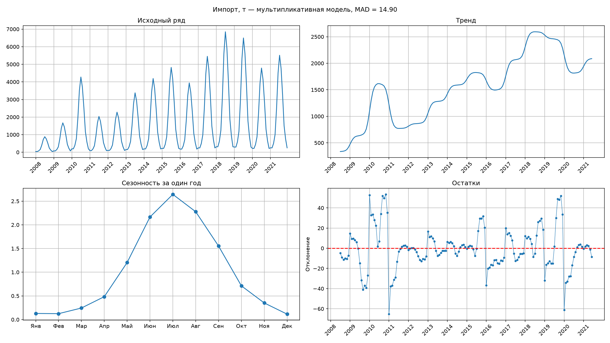
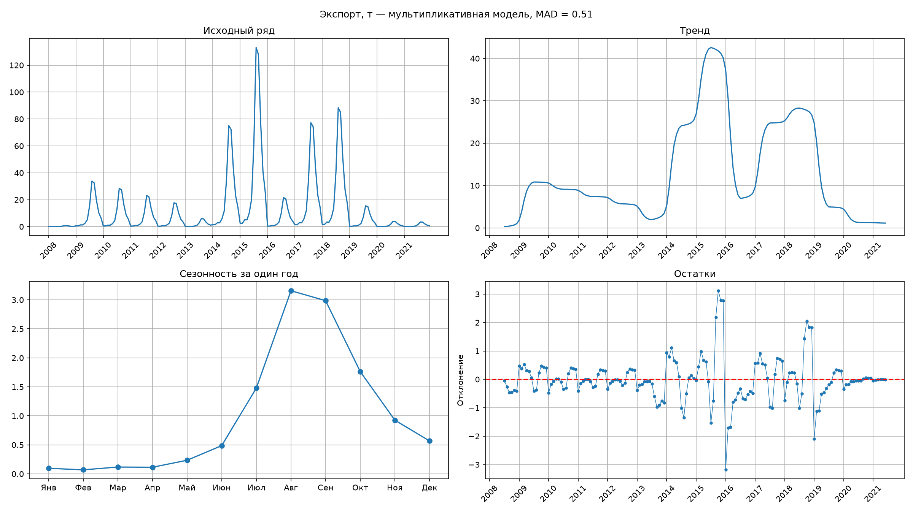
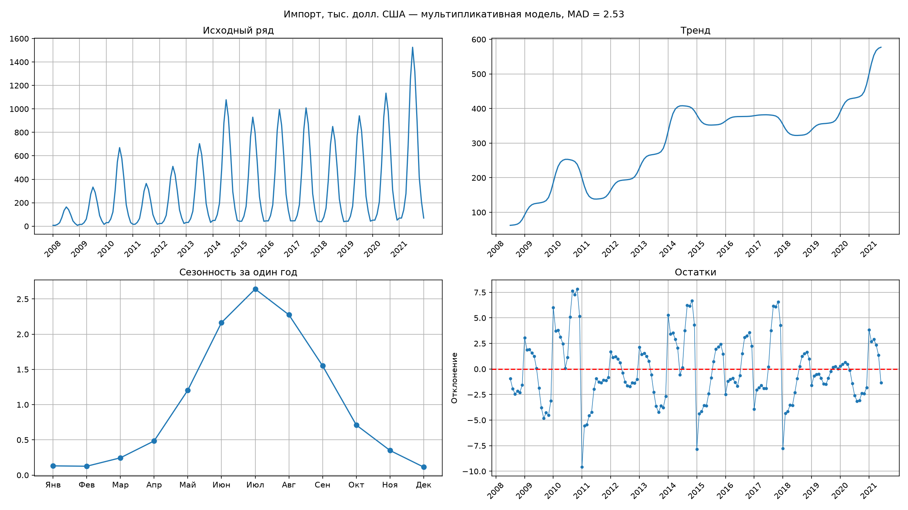
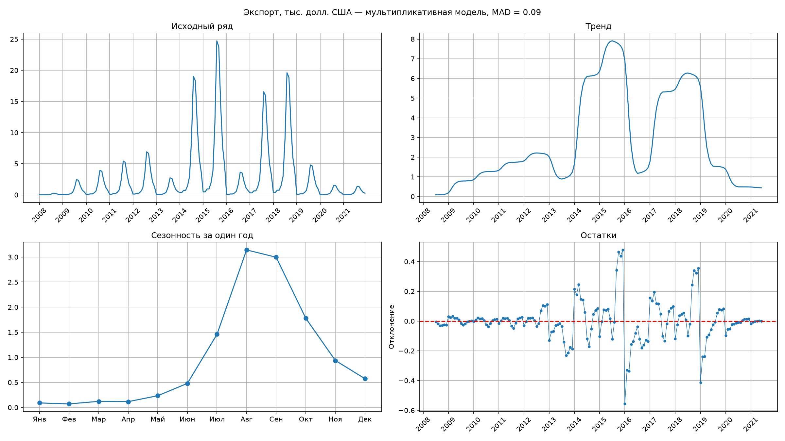

# Задание 2

На основании данных Национального статистического комитета Республики Беларусь https://www.belstat.gov.by/ofitsialnaya-statistika/realny-sector-ekonomiki/vneshnyaya-torgovlya/vneshnyaya-torgovlya-tovarami/godovye-dannye/eksport-i-import-tovarov-6-znakov-tn-ved-eaes/ за 2008-2021 гг. (файлы раздела II Продукты растительного происхождения (.xls), необходимо выполнить:

- декомпозицию рядов (выделение тренда, сезонности и остатков);
- прогноз импорта и экспорта на 2022-2024 годы по товарной группе «Арбузы свежие» (код ТН ВЭД на уровне 6 цифр :080711) в количественном и стоимостном выражении (в результате, должно быть 4 показателя с прогнозом на 3 года каждый). Для прогноза использовать минимум два подхода: статистический (SARIMA, Prophet, др.) и машинного обучения (XGBoost, LightGBM, LSTM, др.). Обосновать выбор лучшей модели на основе метрик качества;
- собрать данные по курсам валют (BYN/USD) за период 2008–2024 гг. и исследовать корреляцию между стоимостью импорта/экспорта арбузов и курсом доллара;
- отобразить визуально исходные данные, компоненты разложения (тренд/цикл/сезонность) и итоговый прогноз с доверительным интервалом средствами Python;
- предоставить подробное текстовое описание методологии, интерпретацию полученных результатов и финальные выводы по каждому блоку анализа;
- результат представить в виде ссылки на github.

## Подготовка данных

Так как часть данных с сайта представлена в виде ПДФ было принято решение не писать парсер данных, а вручную перенести строки для арбузов. Так же я ввел синтетические данные по месяцам, чтобы рассчитать сезонность. Ссылка на файл с данными - [data/data.xlsx](https://github.com/kawunus/data-analysys-test-task/tree/main/task2/data/data.xlsx).

## Декомпозиция рядов

Я разделил ряд значений на тренд, повторяемость и остатки. Графики представлены ниже:

|                       Импорт                        |                       Экспорт                        |
| :-------------------------------------------------: | :--------------------------------------------------: |
|           |           |
|                       Импорт                        |                       Экспорт                        |
|  |  |

По этим графикам видно:

- у импорта тренд - положительный. у экспорта очень сильно колеблется, поэтому сложно сказать, положительный он, или отрицательный.
- наиболее больший экспорт/импорт арбузов получился за июль (что логично, так как это сезон для арбузов). Наименьший - февраль
- остатки колеблятся около нуля без выраженного тренда или сезонного рисунка. Есть выраженные месяцы, где видны отклонения

Сезонность можно было посчитать путем построения одной из моделей - аддиктивной или мультипликативной. Более лучшая модель вычислялась так: считалась величина MAD для каждой модели (Абсолютная средняя ошибка). Та модель, у которой MAD меньше принято считать более точной (так как средняя ошибка у нее и меньше). На этих данных получилось так, что мультипликативная модель во всех 4х случаях оказалась точнее.
