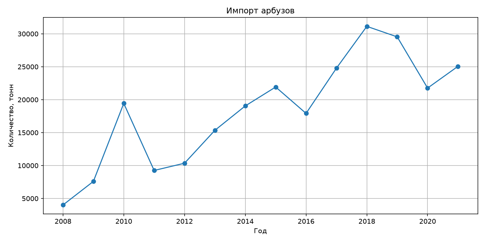
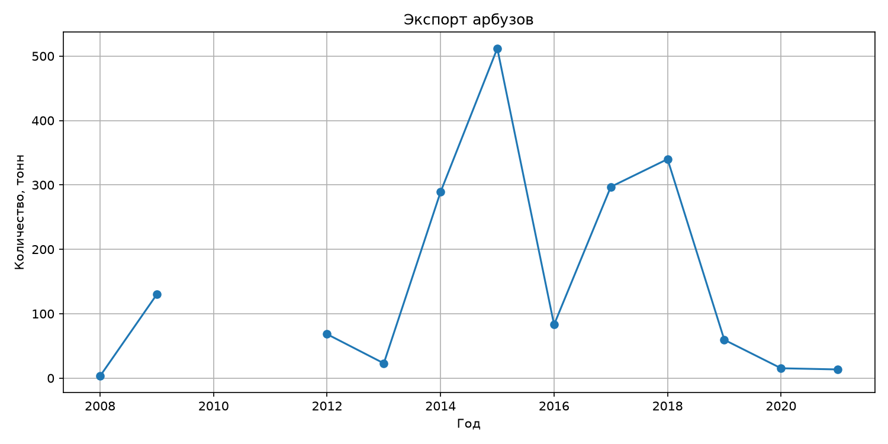
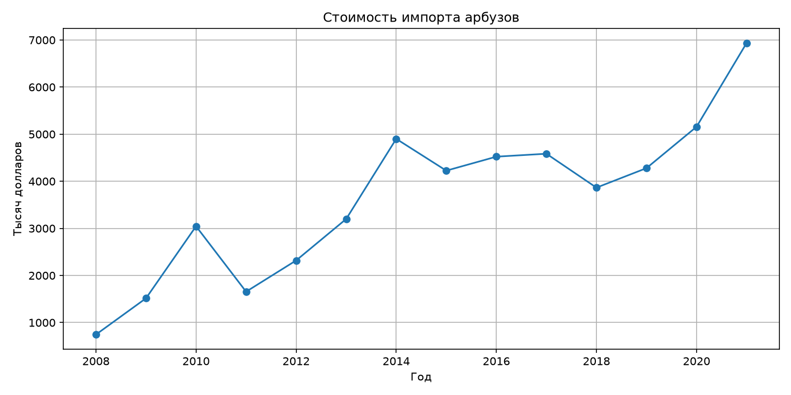
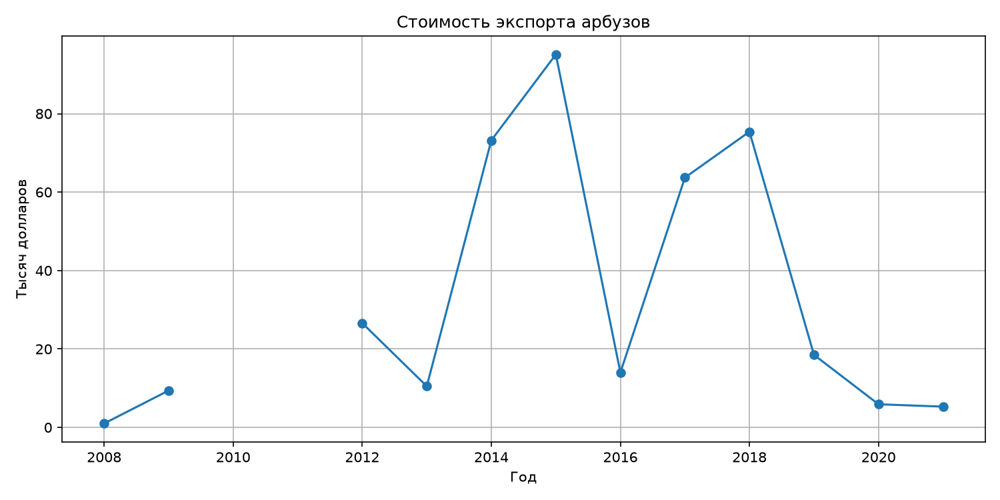

# Задание 2

На основании данных Национального статистического комитета Республики Беларусь https://www.belstat.gov.by/ofitsialnaya-statistika/realny-sector-ekonomiki/vneshnyaya-torgovlya/vneshnyaya-torgovlya-tovarami/godovye-dannye/eksport-i-import-tovarov-6-znakov-tn-ved-eaes/ за 2008-2021 гг. (файлы раздела II Продукты растительного происхождения (.xls), необходимо выполнить:

- декомпозицию рядов (выделение тренда, сезонности и остатков);
- прогноз импорта и экспорта на 2022-2024 годы по товарной группе «Арбузы свежие» (код ТН ВЭД на уровне 6 цифр :080711) в количественном и стоимостном выражении (в результате, должно быть 4 показателя с прогнозом на 3 года каждый). Для прогноза использовать минимум два подхода: статистический (SARIMA, Prophet, др.) и машинного обучения (XGBoost, LightGBM, LSTM, др.). Обосновать выбор лучшей модели на основе метрик качества;
- собрать данные по курсам валют (BYN/USD) за период 2008–2024 гг. и исследовать корреляцию между стоимостью импорта/экспорта арбузов и курсом доллара;
- отобразить визуально исходные данные, компоненты разложения (тренд/цикл/сезонность) и итоговый прогноз с доверительным интервалом средствами Python;
- предоставить подробное текстовое описание методологии, интерпретацию полученных результатов и финальные выводы по каждому блоку анализа;
- результат представить в виде ссылки на github.

## Подготовка данных

Из каждого файла была выбрана строка с кодом 080711 (арбузы)

В некоторых файлах количество товара было в кг, поэтому необходимо было перевести в тонны. После чего данные были объеденены в одну табличку

При первичном анализе видно, что импорт арбузов, намного больше экспорта. По экспорту за 2010 и 2011 год у нас данных нет. По импорту все даненые есть

## Исходные данные

Можно построить несколько графиков количества и стоимости импорта и экспорта в зависимости от года:

|          Импорт, количество          |          Экспорт, количество          |
| :----------------------------------: | :-----------------------------------: |
|  |  |
|          Импорт, стоимость           |          Экспорт, стоимость           |
|                :---:                 |                 :---:                 |
|     |     |
