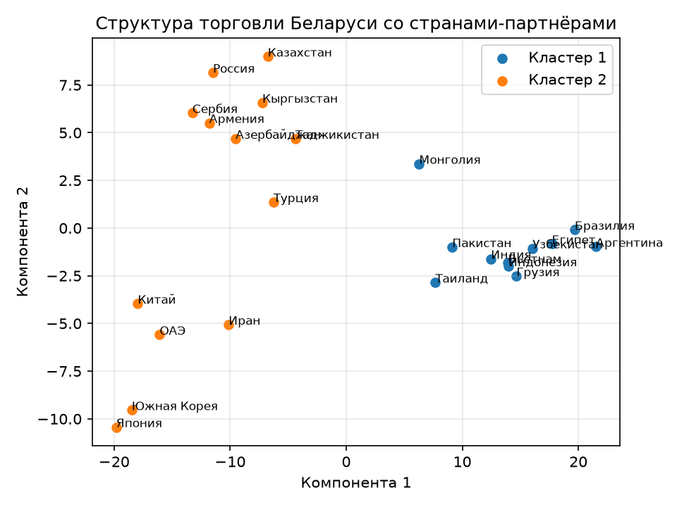

# Задание 3

Выявление групп стран со схожей структурой торговли с Республикой Беларусь. Необходимо:

- на основе данных из п. 1 сформировать матрицу, где строки - страны, а столбцы - доли различных товарных групп в общем объёме торговли с этой страной (в случае отсутствия реальных данных можно использовать синтетические);
- применить алгоритм кластеризации (K-means, DBSCAN, др.) для разделения стран на сегменты;
- проанализировать полученные кластеры - описать их профиль;
- визуализировать результат с помощью методов снижения размерности или на географической карте;
- предоставить подробное текстовое описание методологии, интерпретацию полученных результатов и финальные выводы по каждому блоку анализа;
- результат представить в виде ссылки на github.

## Подготовка данных

Я подготовил синтетические данные по 24 странам по 8 различным отраслям. Данные показывают процентные доли различных групп от общего объема торговли

## Кластеризация

Для кластеризации был использован метод k-means (к средних). Он группирует группы, где похожи признаки. В нашем случае - доли групп. Сначала он выбирает K центров. А затем относит каждую страну к кластеру, на который он больше всего похож признаками. Затем центры пересчитываются внутри групп и все повторяется

Я оценивал кластеры по Silhouette score. Он учитывает на сколько страна похожа на другие страны своего кластера. Он изменяется от -1 до 1. Чем ближе он к 1, тем лучше разделение. В нашем случае - наиболее лучший получился 0.63, где кластеров - 2. Всего анализировалось количество кластеров от 2 до 6.

| Число кластеров | Silhouette score |
| --------------: | ---------------: |
|               2 |             0.63 |
|               3 |             0.60 |
|               4 |             0.48 |
|               5 |             0.43 |
|               6 |             0.40 |

Так как график у нас двумерный, а параметров 8. С помощью PCA мы сводим наши 8 параметров к 2 путем комбинации наших параметров

График того, как страны распределены по кластерам представлен ниже:

В первый кластер вошли Бразилия, Индия, Узбекистан, Грузия, Аргентина, Вьетнам, Египет, Индонезия, Монголия, Пакистан и Таиланд. Во второй — Россия, Казахстан, Армения, Сербия, Турция, Азербайджан, Кыргызстан, Таджикистан, Япония, Южная Корея, Китай, ОАЭ и Иран.

Средние доли товарных групп в кластерах:

| Товарная группа                   | Кластер 1, % | Кластер 2, % |
| --------------------------------- | -----------: | -----------: |
| Продовольствие и сельхозпродукция |         32.8 |         14.2 |
| Древесина и изделия из неё        |         12.9 |          7.2 |
| Металлы и металлоизделия          |          9.6 |         19.0 |
| Машины и оборудование             |         10.8 |         21.0 |
| Автомобили и автокомпоненты       |          6.9 |         14.6 |
| Химическая продукция и полимеры   |         10.7 |         13.1 |
| Лекарства и медизделия            |          4.9 |          4.9 |
| Мебель и прочие товары            |         11.3 |          6.1 |

В первом кластере выше доля продовольствия и сельхозпродукции. Во втором выше доли металлов, машин и оборудования, автомобилей и автокомпонентов. Если интерпретировать на реальный мир, то получится, что первый кластер содержит страны с высоким объемом продовольственно-сырьевых товарных групп, а во втором - промышленных
